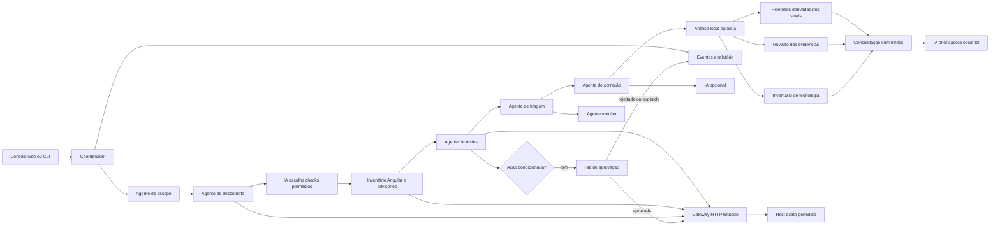

# Pentest com agentes — Hackathon Hubbits, Desafio 3

Pipeline funcional e limitada para receber uma URL HTTPS autorizada, identificar o framework, testar superfícies públicas, registrar evidências, sugerir correções e detectar regressões. O escopo padrão está em [`scope.json`](scope.json): até **11 requisições GET/HEAD**, intervalo mínimo de 1 segundo, até três bundles JavaScript e 512 KiB por resposta. O fragmento `#/` é rota de navegador e não integra a requisição HTTP.

Veja o [plano das oito funcionalidades](docs/PLANO_FUNCIONALIDADES.md), a [análise multiagente por URL](docs/ANALISE_MULTIAGENTE.md) e os [resultados controlados de 12/11/2026](docs/RESULTADOS_2026-11-12.md). As evidências históricas da demonstração permanecem disponíveis; a análise multiagente usa somente os dados de cada campanha.

## Executar

Requer Python 3.11 ou superior; não há dependências Python obrigatórias. Para usar Amazon Bedrock, instale o extra opcional `pip install -e '.[bedrock]'`.

```bash
python3 -m pentest_pipeline scan --config scope.json
python3 -m pentest_pipeline scan --config scope.json --target 'https://4.migbot.com.br//#/tokensale-ico-ea'
python3 -m pentest_pipeline scan --config scope.json --target 'https://example.org/'
python3 -m pentest_pipeline scan --config scope.json --approve-quoted-search
python3 -m pentest_pipeline monitor --config scope.json --baseline reports/baseline.json
python3 -m unittest discover -s tests -v
```

O comando `scan` grava `evidence.json` e `report.md` em `reports/<run_id>/`. `monitor` cria o baseline na primeira execução e, nas seguintes, grava `diff.json` com achados novos, resolvidos, alterados e estáveis. Retorna código 2 quando há achado novo ou alterado; execução incompleta não é comparada nem substitui o baseline. Use `--update-baseline` somente depois de revisar o diff. `Ctrl+C` solicita parada; o evento de parada fica na trilha de auditoria. O par sintético de busca requer `--approve-quoted-search` no CLI; sem isso, o check é pulado e a cobertura fica inconclusiva.
O monitor compara apenas execuções com o mesmo alvo, configuração de escopo e hash das regras de teste. Uma mudança no detector exige novo baseline revisado; não é interpretada como mudança no alvo.

O frontend React/Vite fica em `frontend/`; o servidor Python fornece somente a API local. Em um terminal, execute `python3 -m pentest_pipeline.web_server --port 8765`; em outro, entre em `frontend/`, rode `npm install` e `npm run dev`. O Vite hospeda a interface e encaminha `/api` e `/evidence` ao backend local. Para testar o build de produção, rode `npm run build` e depois `npm run preview` dentro de `frontend/`; o preview do Vite também encaminha as rotas da API.

O console oferece páginas com navegação por fragmento: nova pesquisa (`#home`), acompanhamento (`#research`), achados (`#findings`), relatórios (`#reports`), configurações de IA (`#settings`), escopo (`#scope`) e testes salvos (`#test/<run_id>`). A home centraliza a marca, o campo de URL e dois botões quadrados: ferramentas (abre as configurações em modal, com fechamento por Escape) e pesquisar. O histórico abaixo da busca usa os relatórios locais, não dados do navegador; clicar num quadrado abre os insights, classificações, achados e recomendações daquela execução, sem iniciar outra pesquisa. A API lista até 50 pastas recentes em `/api/history` e retorna os dados de um teste em `/api/history/<run_id>`, aceitando `result.json` ou `evidence.json`. Arquivos inválidos geram avisos explícitos. A navegação preserva o rascunho e não interrompe campanhas.

No modal ou na página de configurações, selecione **OpenAI** ou **AWS Bedrock** e informe o modelo (aceita ID personalizado). OpenAI aceita chave em memória ou a configurada no servidor. Para Bedrock, informe a região e cole a **API key Amazon Bedrock** (bearer token) no campo **Chave do modelo**, abaixo da região. Não use AWS Access Key ID ou Secret Access Key nesse campo. Se ele ficar vazio, o backend usa `AWS_BEARER_TOKEN_BEDROCK` ou as credenciais AWS do servidor. Bedrock exige o extra opcional e as permissões descritas abaixo. Campos vazios de modelo/região usam os padrões do backend para o provedor escolhido. A chave fica somente em memória e é removida ao iniciar, trocar de provedor ou preparar nova pesquisa; ela não entra no relatório, nos eventos ou no Git. As configurações valem para a próxima pesquisa e ficam bloqueadas durante uma execução.

Ao pesquisar, a tela acompanha eventos e insights reais da API, ordenados do mais recente para o mais antigo, com opção de carregar registros anteriores. A triagem alimenta os contadores e rótulos de severidade em tempo real; os achados detalhados aparecem quando o resultado estiver disponível. O acompanhamento permite filtrar verificações, classificações e erros; os achados podem ser filtrados por severidade. Sinais inconclusivos permanecem distintos de observações confirmadas, que não provam exploração. A confirmação de autorização é solicitada antes de iniciar. A interface também permite interromper campanhas, decidir aprovações reais e baixar `/api/report.md` ou `/api/report.json` na página de relatórios. Durante uma nova execução, os downloads podem corresponder à última campanha salva: confira o alvo e o `run_id`. A fila de aprovação expira em cinco minutos; rejeição, expiração e interrupção não executam o par de busca. Cada requisição ainda passa pelas regras de escopo e volume.

A interface usa fundo branco e azul primário `#4a86ee`, com tons mais escuros para texto e contraste. A home exibe a imagem `frontend/public/images/logo-home.png`; mantenha as logos nessa pasta de origem, pois `frontend/dist/` é recriada pelo build. Os ícones dos controles e da navegação usam `lucide-react`, importados individualmente e com nomes acessíveis nos botões. O campo **Chave do modelo** permite mostrar/ocultar a API key do provedor selecionado (OpenAI ou Amazon Bedrock). As transições de página e interações são feitas em CSS e respeitam `prefers-reduced-motion`.

O agente multiagente analisa qualquer URL HTTPS pública autorizada usando o HTML, os scripts permitidos, o inventário de tecnologia e os resultados HTTP da própria campanha. O perfil genérico limita os testes a inventário de framework, cabeçalhos, cookies, `robots.txt` e `security.txt`; checks adicionais da demonstração só são habilitados no escopo configurado para aquele host. Fragmentos SPA são aceitos para navegação, mas removidos antes de qualquer requisição. URLs com credenciais, query, host privado ou esquema diferente de HTTPS são recusadas.

### Orientação opcional por IA

```bash
export OPENAI_API_KEY="..."
export PENTEST_AI_MODEL="gpt-6-luna"  # opcional; este é o padrão
python3 -m pentest_pipeline scan --config scope.json --ai
# Para incluir o par sintético de busca no CLI, acrescente --approve-quoted-search.
```

Com Amazon Bedrock, configure credenciais AWS com permissão `bedrock:InvokeModel`, instale o extra e escolha qualquer model ID, inference profile ID ou ARN compatível com a API Converse:

```bash
pip install -e '.[bedrock]'
export PENTEST_AI_PROVIDER="bedrock"
export PENTEST_BEDROCK_MODEL="amazon.nova-micro-v1:0"
export AWS_REGION="us-east-1"
python3 -m pentest_pipeline scan --config scope.json --ai

# A mesma configuração também pode ser passada por argumentos:
python3 -m pentest_pipeline scan --config scope.json --ai \
  --ai-provider bedrock --ai-model amazon.nova-micro-v1:0 --aws-region us-east-1
```

Os papéis de planejamento, orientação e priorização funcionam nos dois provedores. OpenAI usa a Responses API com `store: false`; Bedrock usa a [API Converse](https://docs.aws.amazon.com/bedrock/latest/userguide/conversation-inference.html) do `bedrock-runtime`. A integração solicita [saída por JSON Schema](https://docs.aws.amazon.com/bedrock/latest/userguide/structured-output.html) quando o modelo oferece esse recurso e faz fallback para JSON restrito, sempre com parsing, allowlists e validação local antes de usar a resposta. O planejador recebe origem e metadados HTTP sanitizados; o orientador recebe IDs, classificações e evidências resumidos de até cinco achados; o revisor recebe somente IDs, checks, estados e severidades tipados, sem corpo de HTML, JavaScript ou resposta. O modelo não recebe ferramentas de rede, não altera a severidade, não confirma uma hipótese e não decide se uma CVE está confirmada. Se a IA falhar, as regras locais continuam e a falha é registrada sem expor credenciais. `.env` e `reports/` são ignorados pelo Git.

O inventário Angular lê, sem executar, até três JavaScripts públicos referenciados pelo HTML e procura um marcador de versão específico. Compara a versão a um catálogo **limitado** de advisories oficiais datado de 12/11/2026. Um CVE só é exibido como possível quando o pacote e a faixa de versão coincidem; exploração exige ainda verificar o código e as condições do aviso. Sem versão exata ou pacote confirmado, o resultado permanece inconclusivo. No alvo, o bundle indica Angular 22.2.2; não há CVE confirmada. Veja [a avaliação Angular](docs/ANGULAR_CVES.md).

## Agentes e dados



| Agente | Trabalho executável |
| --- | --- |
| Escopo | Valida host, esquema, porta, método, caminhos, ritmo e orçamento antes da campanha. |
| Descoberta | Lê a página inicial, até três bundles JavaScript e conta desafios de dificuldades 1 e 2 em `/api/Challenges` no host do laboratório. |
| Inventário Angular | Identifica família e versão por marcadores específicos e cruza avisos do mantenedor sem inferir exploração. |
| Planejamento por IA | Seleciona somente IDs opcionais permitidos; cabeçalhos, cookies e inventário sempre executam. |
| Testes | Confere cabeçalhos e cookies; lê somente índices de `/ftp/`, formato de `/metrics` e compara `q=apple` com `q=apple%27` na busca. |
| Triagem | Deduplica e atribui severidade, estado e confiança a cada evidência. |
| Correção | Anexa dicas condicionais de configuração e código; não presume acesso ao repositório da aplicação. |
| Análise multiagente do alvo | Três agentes locais executam em paralelo: inventariam a tecnologia observada, revisam a suficiência das evidências e formulam hipóteses limitadas aos sinais da campanha. A análise funciona para qualquer URL aceita pelo escopo. |
| Priorização opcional por IA | Ordena hipóteses existentes para revisão humana. Não envia novas requisições ao alvo nem cria achados. |
| Monitor | Compara duas execuções completas por identificador estável de achado. |

Os arquivos desta pasta implementam o **avaliador**, não o código da aplicação avaliada. As dicas de correção devem ser adaptadas à tecnologia do servidor real. A [análise multiagente](docs/ANALISE_MULTIAGENTE.md) registra seus sinais e hipóteses em `observations`, separados de `findings`; sinais passivos não demonstram exploração. Na demonstração, o erro SQLite da busca e o índice `/ftp/` têm [provas e limites próprios](docs/RESULTADOS_2026-11-12.md), preservados sem extrapolar para outras URLs. A captura histórica de `/ftp/` aparece nos novos relatórios da demo apenas se origem, rota e hash do arquivo corresponderem, com legenda que a separa da execução atual.

## Modelo de segurança

- O transporte central aceita apenas `GET` e `HEAD`, valida host exato, HTTPS e porta, bloqueia endereços privados por padrão e **não segue redirecionamentos**. Scripts de outros hosts são recusados. A campanha não baixa arquivos listados em `/ftp/`; verifica por `HEAD` somente os nomes previstos e realmente anunciados pelo índice.
- A fila executa somente checks declarados. Não há força bruta, exploração SQL, injeção adicional, exfiltração, alteração de estado ou aumento automático de profundidade. Credenciais privilegiadas e ações ativas exigem aprovação humana e implementação específica.
- O limite de requisições, o intervalo, o timeout e o teto de corpo estão em `scope.json`. Corpos são analisados em memória e descartados; o log guarda status, metadados limitados e hash SHA-256. URLs são registradas sem query e valores de cookies não são persistidos. A evidência cita somente os dois valores sintéticos usados no teste de busca.
- Cada decisão, requisição, resposta, teste, classificação, orientação e parada produz evento com horário UTC. Estados dos achados: `confirmed` para observação reproduzida, `inconclusive` para sinal que precisa de contexto e `discarded` quando uma hipótese for examinada e refutada. Se faltar cobertura de um teste declarado, a campanha fica `inconclusive`; o monitor só compara campanhas `completed`.
- Ausência de cabeçalho indica configuração a revisar, não prova exploração. A diferença 200/500 com `SQLITE_ERROR` indica erro SQL exposto e entrada mal tratada; não comprova extração, bypass ou SQL injection explorável.
- As hipóteses da análise multiagente são derivadas apenas dos sinais desta campanha e permanecem separadas dos achados HTTP. A IA só prioriza revisão futura. Os agentes paralelos não abrem conexões: as requisições permanecem sequenciais no gateway limitado.
- Respostas HTTP e JavaScript do alvo são dados não confiáveis: não viram instruções para a IA ou para o executor. Evidência de diretório requer marcador de índice e MIME HTML; métricas exigem formato Prometheus; `HEAD 403` não vira vazamento. Conteúdo de SPA que responde 200 em qualquer rota fica inconclusivo quando faltam os marcadores esperados. Consulte [a análise de `/ftp`](docs/FTP_ANALISE.md) e [a avaliação de prompt injection](docs/PROMPT_INJECTION.md).

## API para integração

```python
from threading import Event
from pentest_pipeline import ScopeConfig, run_scan, render_markdown, compare_runs

config = ScopeConfig.from_file("scope.json")
stop_event = Event()
result = run_scan(config, stop_event=stop_event, on_event=lambda event: print(event))
snapshot = result.to_dict()  # JSON serializável; run_scan não grava arquivos
markdown = render_markdown(result)
```

O evento tem `timestamp`, `type`, `phase` e `message`, além de metadados seguros para a fase. `result` contém `run_id`, `status`, `stop_reason`, `findings`, `observations`, `recommendations`, `actions` e `summary`. Cada achado inclui trecho sanitizado, prova, limite, reprodução controlada e, quando houver captura direta pertinente, caminho local e hash da imagem. O plano por etapa registra hipótese, ação, resultado esperado e condição de parada antes do check.
