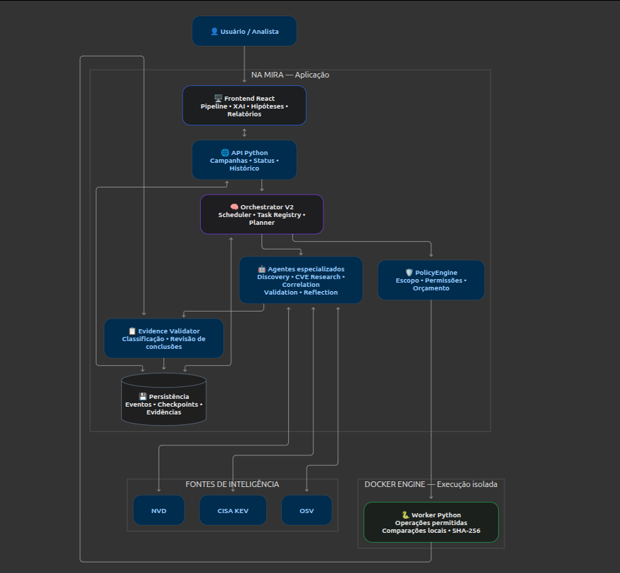
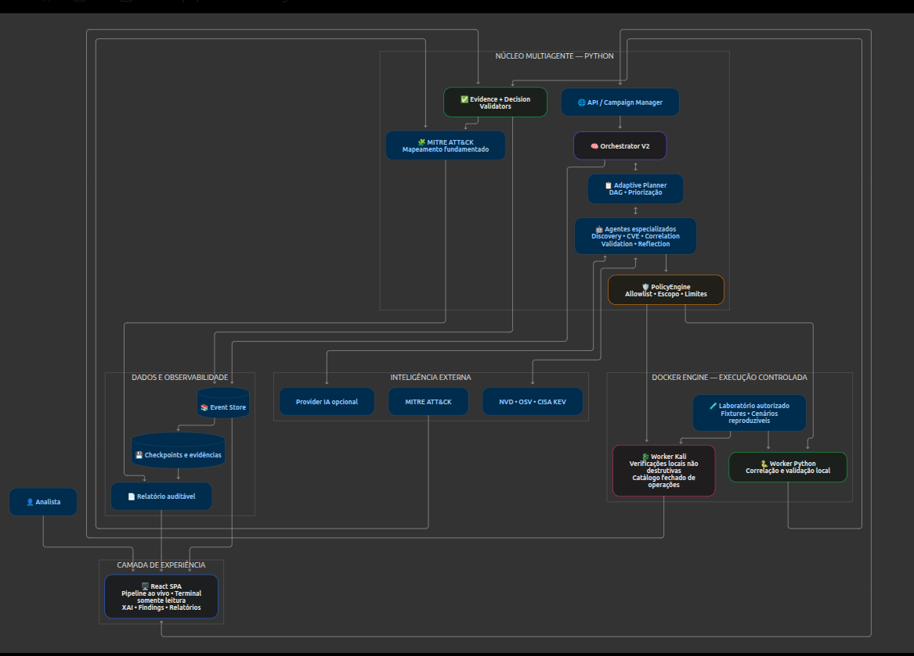

<p align="center">
  
</p>

# NA MIRA

**Análise de segurança assistida por IA, com execução rastreável e evidências antes de conclusões.**

O Na Mira recebe uma URL HTTPS autorizada, identifica tecnologias, realiza verificações limitadas, pesquisa avisos de segurança e organiza hipóteses para revisão. A interface acompanha o trabalho dos agentes e permite consultar decisões, evidências, operações Docker e relatórios da mesma campanha.

Projeto desenvolvido para o **Hackathon Hubbits — Desafio 3**.

[Arquitetura atual](#arquitetura-atual) · [Arquitetura futura](#arquitetura-futura) · [Executar localmente](#executar-localmente) · [Demonstração auditável](#demonstração-auditável) · [Documentação](#documentação)

## O que funciona hoje

- **Pipeline visual de oito etapas:** escopo, descoberta, planejamento, testes seguros, triagem, correção, análise multiagente e monitoramento.
- **Orquestração V2:** catálogo de tarefas, scheduler com dependências, planejamento adaptativo e decisões registradas. Tarefas independentes podem executar em paralelo.
- **Inteligência de vulnerabilidades:** inventário de tecnologias, pesquisa em NVD, OSV e CISA KEV e correlação por produto, ecossistema e versão. Falhas de fontes preservam resultados parciais.
- **Laboratório Docker:** operações locais previamente registradas, autorização por política, comparações de versões e captura de saída dos processos.
- **Validação independente:** Evidence Validator, Reflection Agent e DecisionValidator verificam evidências e revisam conclusões preservando o estado anterior.
- **Observabilidade:** XAI, motivos de tarefas não realizadas, histórico de campanhas, checkpoints, hashes e relatórios Markdown/JSON.
- **IA opcional:** integração com Amazon Bedrock e OpenAI. Os fluxos com fallback determinístico identificam sua origem; a IA não confirma vulnerabilidades.
- **MITRE ATT&CK:** contextualização conservadora de observações, sem execução de técnicas de ataque.

### Execução encerrada não significa análise completa

Os estados operacionais, a completude da análise e a classificação de uma hipótese são apresentados separadamente:

| Dimensão | Exemplo | Significado |
| --- | --- | --- |
| `execution_status` | `completed` | O fluxo operacional terminou. |
| `assessment_status` | `partial` | Permanecem dados ausentes ou verificações sem conclusão. |
| Classificação da hipótese | `potential`, `rejected`, `inconclusive` | Conclusão calculada a partir das evidências disponíveis. |

Uma tarefa `skipped` pode ser uma decisão válida de elegibilidade, desde que seu motivo esteja acessível. Uma correspondência de versão é uma hipótese de aplicabilidade; **não comprova exploração nem comprometimento do alvo**.

## Arquitetura atual

O diagrama menor representa a arquitetura implementada: frontend React, API Python, Orchestrator V2, agentes especializados, políticas, validação de evidências, persistência e worker Python no Docker.

[](docs/architecture/images/architecture-current.png)

| Componente | Responsabilidade |
| --- | --- |
| Frontend React | Pipeline, XAI, achados, hipóteses, verificações e relatórios. |
| API Python | Iniciar e interromper campanhas; consultar status, histórico, evidências e relatórios. |
| Orchestrator V2 | Organizar tarefas registradas e respeitar dependências, estados e prioridades. |
| Agentes especializados | Descobrir tecnologias, pesquisar avisos, correlacionar dados, registrar hipóteses e selecionar verificações. |
| PolicyEngine e escopo | Aplicar permissões, elegibilidade e limites antes da execução autorizada. |
| Worker Python | Executar operações locais do catálogo fechado, em containers com isolamento e limites. |
| Validação independente | Avaliar integridade, proveniência e suficiência; propor e validar revisões de classificação. |
| Persistência | Conservar eventos, checkpoints, evidências e revisões para consulta posterior. |

O fluxo preserva a relação entre inventário, avisos, correlação, hipóteses, verificações, revisão e relatório. Uma resposta textual da IA não substitui o resultado do executor especializado.

## Arquitetura futura

O diagrama maior representa a **visão de evolução**, não uma declaração de que todas as integrações mostradas já estão disponíveis.

[](docs/architecture/images/architecture-future.png)

A evolução proposta amplia o laboratório autorizado com cenários reproduzíveis e um **worker Kali dedicado a verificações locais não destrutivas**, sempre limitado a um catálogo fechado de operações e às decisões de política. Também prevê ampliar a integração de inteligência MITRE com o fluxo de investigação.

Orchestrator V2, planejamento, Event Store, validação independente, relatórios e contextualização MITRE já fazem parte do projeto atual. Sua presença no desenho futuro mostra como esses componentes se integram à evolução planejada.

**O worker Kali desse desenho ainda não faz parte da execução demonstrada.** Hoje, a PoC executa workers Python no Docker e comparações locais de dados; não demonstra execução de técnicas MITRE ou exploração no Kali.

## Executar localmente

### Requisitos e instalação

- Python **3.11 ou superior**.
- Node.js **22 ou superior** e npm para o frontend e o harness de navegador.
- Docker Engine acessível ao usuário que executa a API e o seed.
- Credenciais de um provedor para novas varreduras com IA pela interface. **A demonstração auditável funciona sem credenciais externas.**

Clone o [repositório](https://github.com/erickpxd/hackats-namira) e execute na raiz:

```bash
python3 -m venv .venv
.venv/bin/python -m pip install -e './backend[bedrock]'
npm --prefix frontend ci
docker build --network=none -f backend/Dockerfile.worker -t namira/worker:local backend
```

A instalação editable mantém as fixtures e os caminhos do projeto disponíveis. A imagem base `python:3.12-slim` precisa estar disponível ou ser obtida durante o build. A execução dos workers usa rede desligada.

### Ambiente e API

Use [`backend/.env.example`](backend/.env.example) como referência e crie seu `backend/.env` privado, preservando qualquer configuração existente. Preencha as credenciais reais somente nesse arquivo ou no ambiente do processo. Não use variáveis `VITE_*` para segredos.

**O Python não carrega `.env` automaticamente.** Em um terminal Bash, na raiz:

```bash
set -a
. backend/.env
set +a
.venv/bin/python -m pentest_pipeline.web_server --port 8765
```

A API fica em `http://127.0.0.1:8765`. Os flags estão documentados no arquivo de exemplo: `PENTEST_ORCHESTRATOR=v2`, `PENTEST_CVE_INTELLIGENCE=1`, `PENTEST_AI_PLANNING=1`, laboratório e validação independente habilitados. Nos dois flags com valor `1`, escrever `enabled` não ativa a funcionalidade.

Para Bedrock, configure `AWS_BEARER_TOKEN_BEDROCK` ou use credenciais/role AWS autorizadas, além de modelo e região. O token Bedrock não é uma AWS Access Key ID. Para OpenAI, configure `OPENAI_API_KEY` e os seletores de provider correspondentes. O exemplo versionado não contém credenciais reais.

### Frontend

Em outro terminal, na raiz:

```bash
npm --prefix frontend run dev
```

Abra **[http://localhost:5173](http://localhost:5173)**. O Vite encaminha `/api` e `/evidence` para a API local.

| Tela | Rota |
| --- | --- |
| Nova varredura e histórico | `/#home` |
| Acompanhamento e XAI | `/#research` |
| Achados | `/#findings` |
| Verificações e hipóteses | `/#executions` |
| Relatórios | `/#reports` |
| Configuração do projeto | `/#settings` |
| Campanha salva | `/#test/<run_id>` |

## Demonstração auditável

O seed cria **NA MIRA — Demonstração Auditável** pelo fluxo real de orquestração, com fixtures explicitamente identificadas e processos Docker reais.

Com a imagem construída, execute na raiz:

```bash
env PENTEST_AI_PLANNING=0 PENTEST_AI_PLANNING_PROVIDER= PENTEST_REFLECTION_PROVIDER= .venv/bin/python -m pentest_pipeline.demo.seed_campaign --demo
```

Essas variáveis valem apenas para o processo do seed: mantêm a reflexão determinística e evitam chamadas a modelos externos. A configuração do serviço continua independente. O seed não consulta alvos externos.

Cada execução cria um novo `run_id`, preserva tentativas anteriores e gera:

- **Quatro workers Docker reais:** diagnóstico do ambiente e três comparações.
- Saídas de comandos fixos: versão do Python, usuário, sistema e SHA-256 da fixture.
- Casos `supported`, `contradicted` e `inconclusive`, com hipóteses `potential`, `rejected` e `inconclusive`.
- Revisão **suspected → rejected**, com estado anterior preservado.
- Rejeição de operação desconhecida antes de criar worker.
- Resultado **`completed` para execução e `partial` para análise**.

Abra `http://localhost:5173/#test/<run_id>` usando o ID retornado pelo comando. Em **Verificações e hipóteses desta campanha**, abra uma operação e depois **Saída real do processo** para consultar stdout e stderr. A visualização é somente leitura; IDs e hashes ficam nos detalhes de auditoria.

Relatório, manifesto e dados ficam em `backend/reports/<run_id>/`. Checkpoints e capturas ficam em `backend/reports/checkpoints/` e `backend/reports/worker-captures/`. A API e o seed devem acessar esses mesmos diretórios, com permissões do usuário do serviço.

Consulte o [relatório da demonstração validada](docs/architecture/auditable-demo-report.md) e o [manifesto com IDs, revisões e hashes](docs/architecture/auditable-demo-manifest.json). São registros de uma execução local anterior, não resultados de um novo deploy.

## Segurança e limites

- Varreduras exigem escopo autorizado. O transporte limita origem, métodos, volume, intervalo, timeout e tamanho das respostas; endereços privados são bloqueados por padrão e redirecionamentos não são seguidos.
- As regras da campanha ficam em [`backend/scope.json`](backend/scope.json). A IA não amplia o escopo nem envia comandos arbitrários ao worker.
- Workers usam rede `none`, usuário não root, filesystem read-only, `cap-drop ALL`, `no-new-privileges`, tmpfs limitada e limites de CPU, memória, processos e tempo. O socket Docker não é montado dentro deles.
- Saídas capturadas têm limite, redação de campos sensíveis, sanitização e hash do registro sanitizado. A retenção padrão é de sete dias, configurável por `PENTEST_CAPTURE_RETENTION_DAYS`.
- Fontes indisponíveis, versão desconhecida e dados insuficientes permanecem explícitos. Ausência de evidência não é prova de ausência de vulnerabilidades.
- Contextualização MITRE, correlação de versões e conclusão de tarefas não comprovam exploração ou comprometimento.

## Validação

Baseline registrado em **13/11/2026**:

| Verificação | Resultado |
| --- | --- |
| Suíte Python com Docker real habilitado | **348 aprovados, zero falhas e zero pulados** |
| Build do frontend | Aprovado |
| Navegador — demonstração auditável | 15 verificações aprovadas |
| Navegador — regressão da Fase 7 | 18 verificações aprovadas |

Para repetir a suíte, use um terminal sem as flags do serviço carregadas e execute dentro de `backend/`:

```bash
PENTEST_DOCKER_IT=1 ../.venv/bin/python -m unittest discover -s tests -q
```

Na raiz, com a API ativa e o seed gerado:

```bash
npm --prefix frontend run build
node tools/e2e-web/run_phase65.mjs --demo-run ID_DA_CAMPANHA
node tools/e2e-web/run_phase65.mjs --phase7
```

O harness de navegador exige Chrome disponível. Os resultados completos estão nos [registros de testes](docs/architecture/auditable-demo-tests.json), [aceite da demo](docs/architecture/auditable-demo-browser.json) e [aceite da Fase 7](docs/architecture/phase7-browser-acceptance.json).

## Estrutura do repositório

```text
backend/
  pentest_pipeline/
    orchestration/   # Registro, scheduler, DAG, eventos e projeções
    intelligence/    # Tecnologias, fontes, correlação e hipóteses
    execution/       # Políticas, laboratório, Docker e captura
    validation/      # Evidências, reflexão e decisões
    planning/        # Planejamento adaptativo
    persistence/     # Checkpoints
    mitre/           # Contextualização ATT&CK
    demo/            # Fixtures e seed auditável
  tests/
  Dockerfile.worker
  .env.example
frontend/            # React, Vite e componentes da interface
docs/                # Arquitetura, auditorias e deploy
tools/               # Verificações Docker e testes de navegador
```

## Documentação

O deploy completo precisa de frontend estático, API persistente, Docker real e armazenamento durável para `backend/reports/`. Hospedar apenas o frontend não disponibiliza a execução dos agentes.

O [prompt de deploy para o Kiro](docs/deploy/kiro-deploy-prompt.md) orienta a configuração do ambiente, credenciais privadas, proxy, serviço, persistência, execução do seed e validação da URL publicada.

| Documento | Conteúdo |
| --- | --- |
| [Progresso da migração](docs/architecture/migration-progress.md) | Fases implementadas e resultados registrados. |
| [Auditoria da orquestração e demo](docs/architecture/orchestration-auditable-demo.md) | Causas dos skips, correções, reprodução e limitações. |
| [Plano do Orchestrator V2](docs/architecture/orchestrator-v2-plan.md) | Organização da orquestração. |
| [Auditoria dos contratos da Fase 7](docs/architecture/phase7-contract-audit.md) | Validação independente e revisão de conclusões. |
| [Verificações de navegador](tools/e2e-web/README.md) | Comandos e critérios de aceite da interface. |
| [Análise multiagente](docs/ANALISE_MULTIAGENTE.md) | Contexto dos agentes e hipóteses. |
| [Resultados históricos do desafio](docs/RESULTADOS_2026-11-12.md) | Evidências da demonstração original e seus limites. |

Os comandos CLI `scan` e `monitor` continuam disponíveis para os fluxos legados. Consulte `.venv/bin/python -m pentest_pipeline --help` para as opções de execução.
