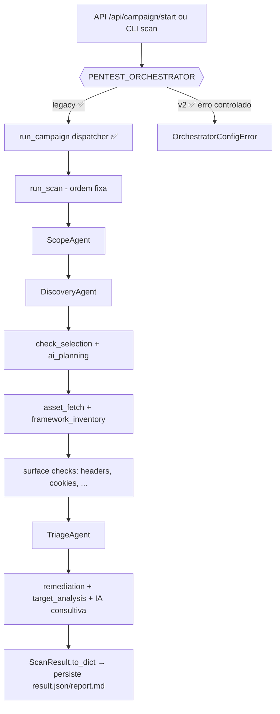
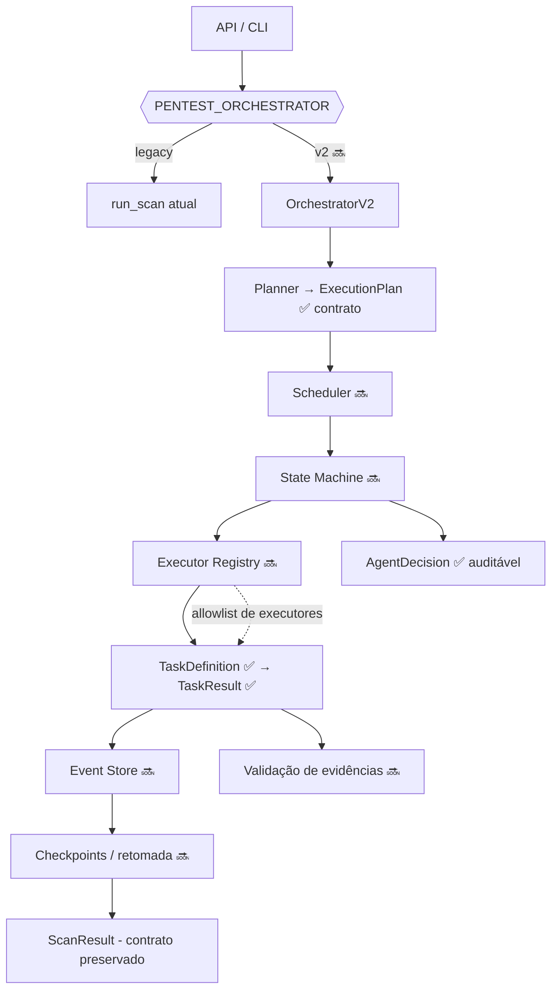

# Plano do Orquestrador v2 — Migração Incremental

> **Estado:** Fase 1 concluída. Este documento separa explicitamente o que **já
> foi implementado** do que é **apenas planejamento** para a Fase 2+.

## Legenda
- ✅ **Implementado na Fase 1**
- 🔜 **Planejado (Fase 2+)** — não existe em código

## 1. Arquitetura atual

`run_scan` (em `pipeline.py`) executa uma sequência fixa de etapas, cada uma
com um plano declarado (`stage_plan.py`), agentes determinísticos
(`agents.py`), comunicação limitada (`BoundedTransport`) e IA apenas
consultiva (`ai.py`). O resultado (`ScanResult`) é persistido ao final.

## 2. Arquitetura pretendida (Fase 2+)

Orquestrador orientado por **tarefas, evidências e decisões**: um planejador
produz um `ExecutionPlan`, um scheduler respeita dependências, executores
registrados realizam tarefas sob uma máquina de estados, e um event store com
checkpoints permite retomada. Escopo/orçamento continuam sendo propriedade de
`ScopeConfig`/`BoundedTransport`.

## 3. Contratos introduzidos (✅ Fase 1)

Em `backend/pentest_pipeline/contracts/` (stdlib, frozen dataclasses,
`to_dict`/`validate`, sem segredos, independentes do frontend):

| Contrato | Papel | Relações |
|---|---|---|
| `CampaignContext` | Identidade + correlação + descritor de IA; **referencia** `ScopeConfig` (escopo e orçamento), sem duplicar. | contém `AIConfig`, `ScopeConfig` |
| `TaskDefinition` | Unidade de trabalho planejada (dado, não código). Guarda de allowlist para tipo/executor. | contém `ExecutionLimits`, `RetryPolicy` |
| `TaskResult` | Resultado normalizado de uma tarefa. | contém `NormalizedError` |
| `ExecutionPlan` | Conjunto versionado de tarefas, com dependências validadas (sem ciclos) e origem (`ai`/`deterministic`/`operator`). | contém `TaskDefinition[]` |
| `AgentDecision` | Decisão auditável com justificativa, alternativas e origem. | — |

**Guarda anti-execução de texto de IA:** `TaskDefinition.validate(allowed_types,
allowed_executors)` recusa qualquer tarefa cujo tipo/executor não esteja numa
allowlist fornecida pelo chamador. Texto de IA é tratado como dado inerte.

## 4. Feature flag (✅ Fase 1)

`backend/pentest_pipeline/orchestration/config.py`:
- `PENTEST_ORCHESTRATOR` ∈ {`legacy` (default), `v2`}.
- `resolve_mode()` — recusa valores desconhecidos (erro explícito).
- `ensure_executable()` — `v2` levanta `OrchestratorConfigError` enquanto
  `is_v2_implemented()` for `False`. **Único ponto a inverter na Fase 2.**
- `run_campaign()` (`entry.py`) — dispatcher único; delega a `run_scan` no modo
  legacy, repassando `**kwargs`. Sem duplicar lógica, sem fallback silencioso.

## 5. Integrações que precisarão ser adaptadas

| Ponto | Fase 1 | Fase 2 |
|---|---|---|
| `web_server.CampaignConsole.start` | ✅ pré-checa a flag e recusa v2 | roteará para `OrchestratorV2` |
| worker `CampaignConsole._run` | ✅ chama `run_campaign` (legacy) | chamará `OrchestratorV2.run` |
| `__main__.scan` | ✅ chama `run_campaign` (legacy) | idem |
| Testes da API | ✅ mockam `web_server.run_campaign` | idem |

## 6. Sequência planejada de migração

1. **Fase 1 (✅):** baseline, testes de regressão, contratos, flag, estrutura.
2. **Fase 2:** Event Store + persistência (`persistence/`), máquina de estados,
   scheduler e registro de executores adaptando os agentes atuais como executores.
3. **Fase 3:** planejador que emite `ExecutionPlan`; equivalência verificada
   contra o legado (mesmos achados nas mesmas evidências).
4. **Fase 4:** checkpoints/retomada; replanejamento; validação de evidências.
5. **Fase 5:** habilitar `v2` por padrão após paridade comprovada; depreciar o
   caminho fixo de `run_scan`.

## 7. Estratégia de compatibilidade

- Contrato de `ScanResult`/`Finding` e os campos consumidos pelo frontend são
  **pinados por teste** (`tests/test_migration_regression.py`).
- `run_campaign(legacy)` é verificado como **idêntico** a `run_scan` nos campos
  estáveis (status, `selected_checks`, `ruleset_hash`, nº de achados).
- A API/CLI não mudam assinatura nem endpoints.

## 8. Estratégia de rollback

Ver `migration-baseline.md §8`. Resumo: manter `legacy` (padrão); reverter o
wiring; remover `contracts/`/`orchestration/`. Nada de migração de dados.

## 9. Dependências para a Fase 2

- Diretório `persistence/` (🔜 — **não criado na Fase 1**, para não simular
  arquitetura pronta): Event Store + checkpoints.
- Registro de executores que **adapte** os agentes determinísticos atuais sem
  reescrevê-los.
- Mapeamento `TaskDefinition.task_type` → check existente (reaproveitar
  `scope.available_checks()` como allowlist inicial).
- Decidir o backend de persistência (arquivo JSON append-only vs. SQLite).

## 10. Riscos conhecidos

- Divergência entre trilha ao vivo e persistida (herdada) — resolver com Event
  Store único na Fase 2.
- IA propondo tarefas fora do escopo — mitigado pela allowlist de contrato;
  reforçar com validação no scheduler.
- Crescimento de superfície sem paridade comprovada — mitigado pela ordem de
  migração (executores antes do planejador).

## 11. Decisões arquiteturais ainda pendentes

1. Backend de persistência do Event Store (JSONL vs. SQLite).
2. Formato de checkpoint e granularidade (por tarefa vs. por fase).
3. Como expor progresso por tarefa no `/api/status` sem quebrar o contrato
   atual (campo aditivo opcional).
4. Política de repetição real (backoff) vs. apenas declarativa (`RetryPolicy`).
5. Se `CampaignContext` deve ganhar `from_dict` (hoje só `to_dict`, pois é
   construído no início da campanha, não restaurado).
